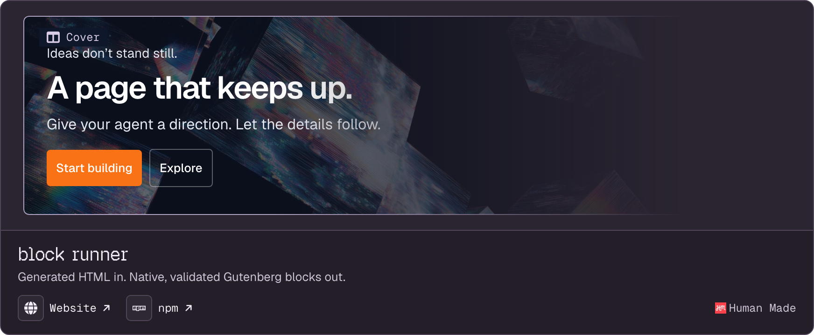
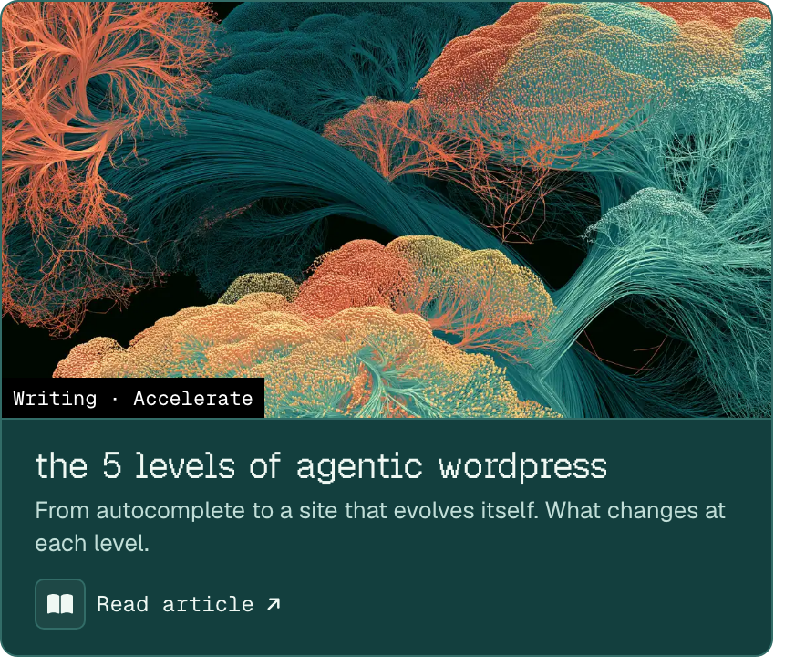
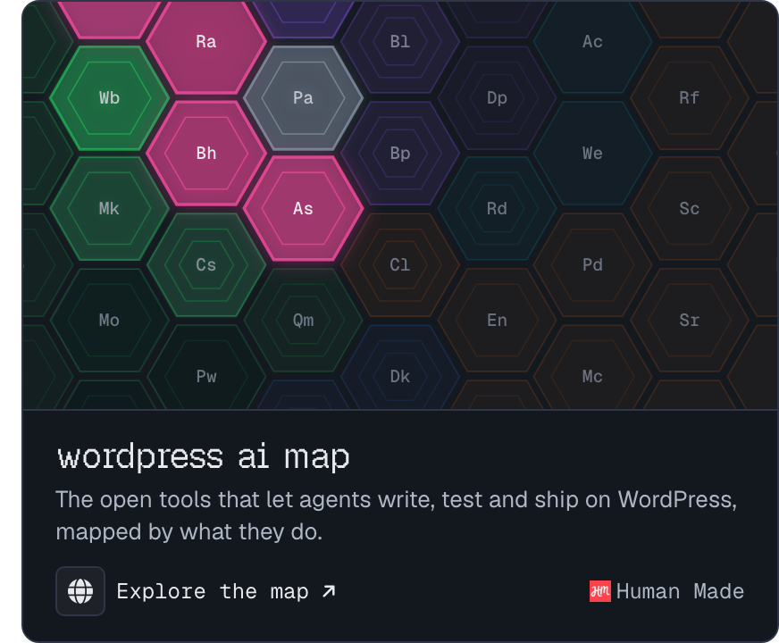
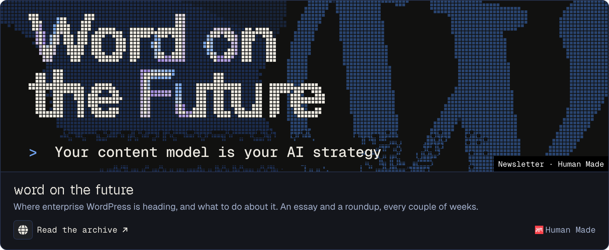
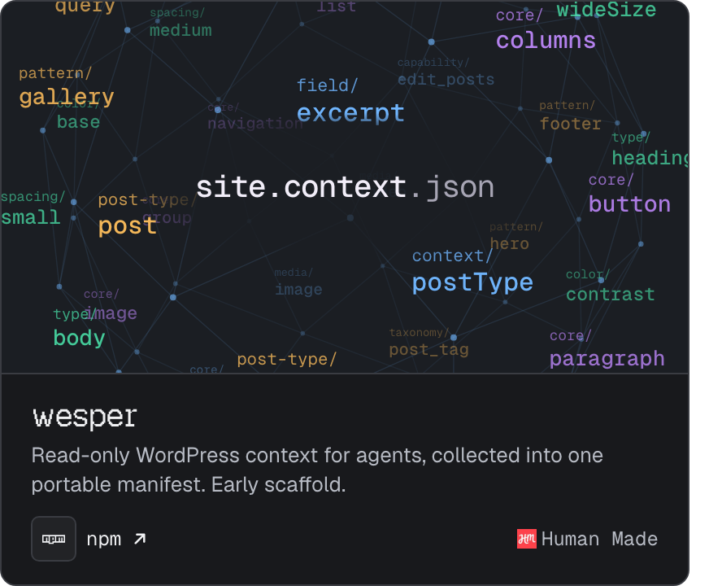
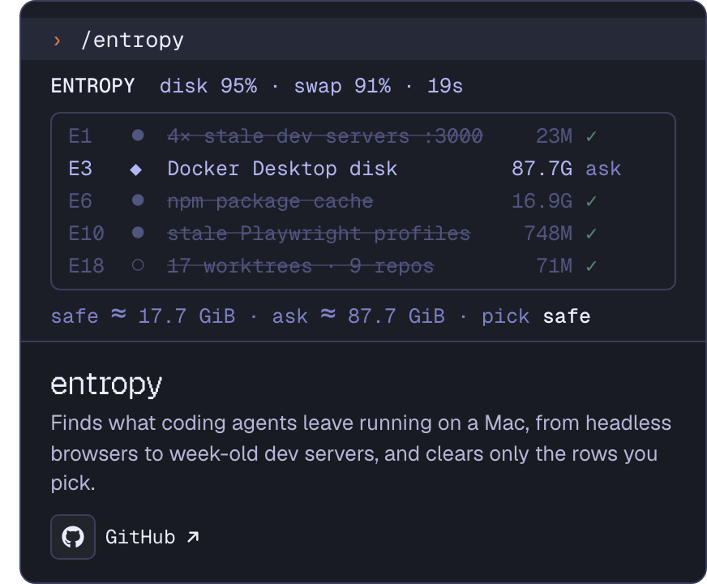
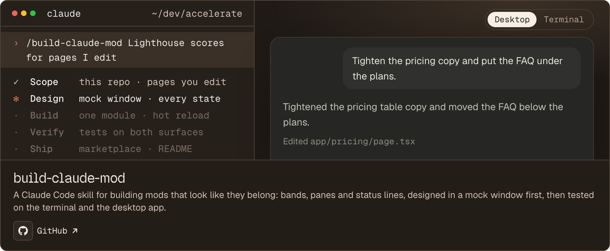

Building with agents every day, for my own work and at [Human Made](https://humanmade.com/). More at [noeltock.com/ai](https://noeltock.com/ai) · [LinkedIn](https://www.linkedin.com/in/noeltock/)

